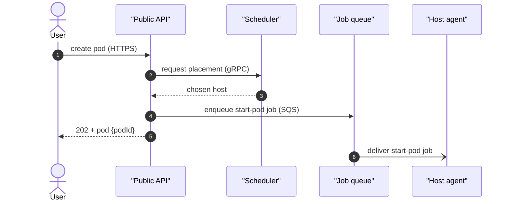

# Mermaid Diagrams

This skill turns a diagram brief into Mermaid source that validates and renders in Obsidian and Notion. It covers syntax only.

**What to draw is owned by the `drawing-diagrams` skill.** That skill sets the question, the view and zoom level, the form, the element and edge labels, the size limits, and what stays out of the diagram. Invoke it before writing any Mermaid. If the two skills seem to disagree, `drawing-diagrams` wins on content.

## Workflow

1. Run `drawing-diagrams` to get the brief: question, reader, view, level, form, elements with labels, edges with verb + protocol, and legend. If the form is a table, write a markdown table and stop.
2. Pick the Mermaid type for the form (table below).
3. Write the source using the encoding and syntax rules below.
4. Validate with `scripts/validate.sh` (relative to this skill dir). Fix errors until it returns `ok`.
5. Deliver:
   - If the user gave a target file path, write the diagram to that file as a fenced ` ```mermaid ` block.
   - Otherwise emit the fenced block in the chat response.
   - Put the diagram's question as its heading. Put the legend, `file:line` references, and open questions in prose under the block.

## Form to Mermaid type

| Form from the brief | Mermaid type |
|---|---|
| sequence diagram | `sequenceDiagram` |
| box-and-arrow / component graph | `flowchart LR`, or `flowchart TD` for hierarchies |
| state machine | `stateDiagram-v2` |
| deployment diagram | `flowchart` with one `subgraph` per cloud, region, or DC, and no call edges |
| data model (entities and cardinality) | `erDiagram` |
| business process (steps and decisions) | `flowchart LR`, with `{}` diamonds for decisions |
| table | markdown table, not Mermaid |

## Encoding drawing-diagrams conventions

| Convention | Mermaid |
|---|---|
| Element label: name, type, responsibility | `S["Scheduler<br/>Go service<br/>picks host, reserves GPU"]` |
| Data store | cylinder: `DB[("Postgres")]` |
| User or actor | stadium `U(["Customer"])` in a flowchart; `actor User` in a sequence |
| Edge label: verb + protocol | `A -- "enqueues start-pod job (SQS)" --> B` |
| L3 boundary box | `subgraph SCHED["Scheduler"] ... end`, with neighbor containers outside it |
| Request / reply in a sequence | `->>` request, `-->>` reply |
| `[NEW]` / `[CHANGED]` | keep the tag in the label text, then add a fill with `classDef` and `class` |
| Legend | prose line under the block (see below) |

Mermaid has no legend primitive. Write the legend as prose directly under the block, e.g. `Legend: green fill = new in this change; dotted arrow = async event.` Don't build a legend out of a `subgraph`. It adds nodes and the layout engine places it unpredictably.

## Syntax rules

These are the pitfalls agents hit most often. Validation catches all of them, but writing them right the first time avoids retry loops.

### General

- **Quote labels that contain spaces, punctuation, or parentheses.** `A["Submit form"]`, not `A[Submit form]`.
- **Use `<br/>` for line breaks inside labels**, not newlines.
- **Wrap the whole label in double quotes** when it contains parentheses, brackets, colons, or semicolons.
- **Avoid HTML entities** unless the label is already quoted.
- **Use `%%` for line comments.** They're stripped before rendering.
- **A `subgraph` id can't reuse a node id.** Give the subgraph its own id and put the display name in brackets: `subgraph SCHED["Scheduler"]`.

### Flowchart (`flowchart` / `graph`)

- Direction: `flowchart LR` for sequential flows, `flowchart TD` for hierarchies.
- Shapes: `A[rect]`, `A(round)`, `A([stadium])`, `A[(cylinder)]`, `A{diamond}`, `A((circle))`, `A>flag]`.
- Arrows: `-->` solid, `-.->` dotted, `==>` thick. Labels: `A -->|"label"| B` or `A -- "label" --> B`.
- Styling: `classDef new fill:#d3f9d8,stroke:#2b8a3e` then `class A,B new`, or inline `A:::new`.

### Sequence (`sequenceDiagram`)

- **Declare participants at the top** in layout order: `participant API as "Public API"`. Use `actor` for people.
- Arrows: `->>` solid request, `-->>` dashed reply, `-)` async / fire-and-forget.
- Notes: `Note over A,B: text`. Keep each to one short clause.
- Control flow: `loop`, `alt` / `else`, `opt`, `par`, each closed with `end`.
- `autonumber` on its own line numbers every message, which helps when prose refers to steps.

### State (`stateDiagram-v2`)

- Always `stateDiagram-v2`, never the legacy `stateDiagram`.
- `[*]` is the start and end pseudo-state.
- Transitions: `Pending --> Running : backend provisioned`. The label is the trigger.
- Composite states: `state Outer { Inner1 --> Inner2 }`. Use sparingly.

### ER (`erDiagram`)

- Relationships: `USER ||--o{ ORDER : places` (one user, zero or many orders).
- Cardinality glyphs: `||` exactly one, `|o` zero or one, `}o` zero or many, `}|` one or many.
- Attributes: `USER { uuid id PK string email }`. Include only the fields the question needs.
- Entity names in UPPER_CASE by convention.

## Host rendering quirks (validation won't catch these)

`mmdc` checks that the source parses. It doesn't check how Obsidian or Notion render it.

- **No angle-bracket placeholders.** `A["Send <token>"]` passes `mmdc`, but Obsidian and other HTML-rendering hosts treat `<token>` as a tag and strip it, leaving `Send`. Use curly braces: `A["Send {token}"]`. This applies to node labels, sequence messages, and notes.
- **Prefer classic syntax over the newest features.** Local `mmdc` can be a newer Mermaid than the one Obsidian or Notion bundles, so syntax added in recent releases (such as `A@{ shape: ... }`) can validate locally and then fail in the note. Stick to the shapes and arrows listed above.

## Validation (mandatory)

Validate every diagram before delivery:

```bash
# From the skill's scripts/ dir:
echo '<mermaid source>' | bash scripts/validate.sh -
# or with a file:
bash scripts/validate.sh diagram.mmd
```

`validate.sh` prints `ok` on success or the `mmdc` error on failure. Iterate until it prints `ok`.

If `mmdc` isn't installed:

```bash
npm install -g @mermaid-js/mermaid-cli
```

## Example: brief to delivered Mermaid

Brief from `drawing-diagrams`:

```
Question: How does a pod create request reach a host?
Reader:   new backend engineer, first week
View:     behavior
Level:    L2 container
Form:     sequence diagram
```

Delivered:

````markdown
## How does a pod create request reach a host?



- Placement logic: `scheduler/placement.go:88`.
- Open question: does the host agent poll SQS or receive a push?
````

## Self-check before delivering

- [ ] The content came from a `drawing-diagrams` brief.
- [ ] Validated with `scripts/validate.sh` and got `ok`.
- [ ] The Mermaid type matches the brief's form.
- [ ] No angle-bracket placeholders. Use `{var}`.
- [ ] No syntax newer than the classic shapes and arrows above.
- [ ] Labels with spaces or punctuation are quoted.
- [ ] Legend, `file:line` references, and open questions are in prose under the block, not inside it.
- [ ] If a target file path was given, the diagram was written there as a fenced ` ```mermaid ` block.
